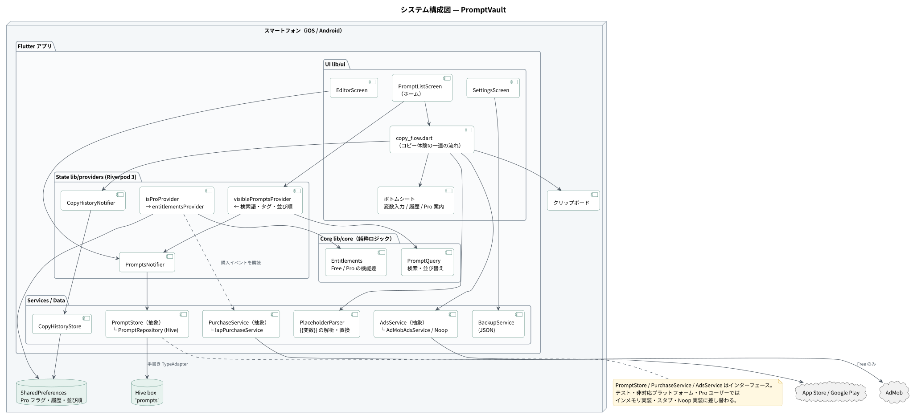
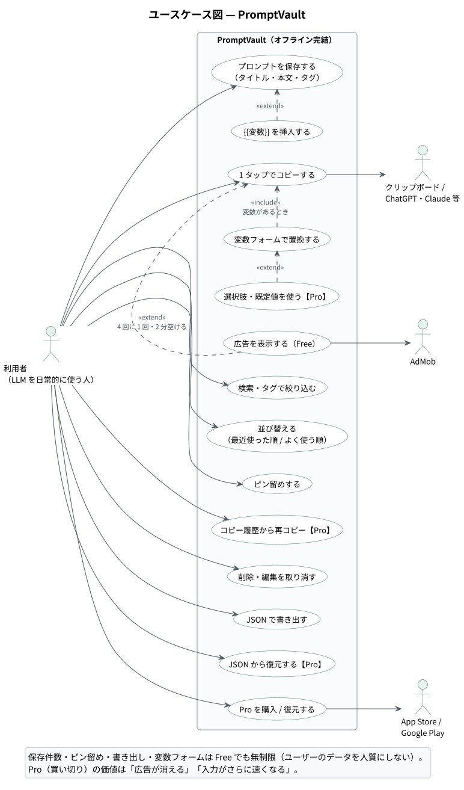
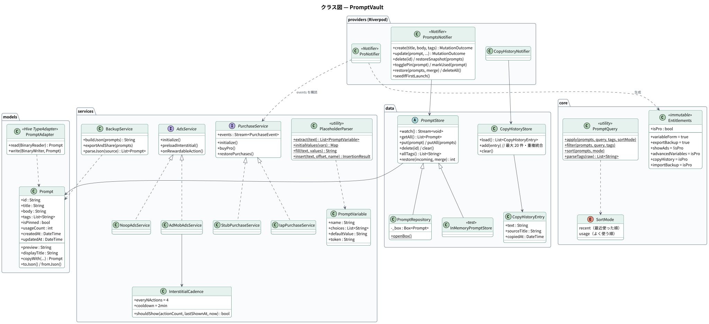
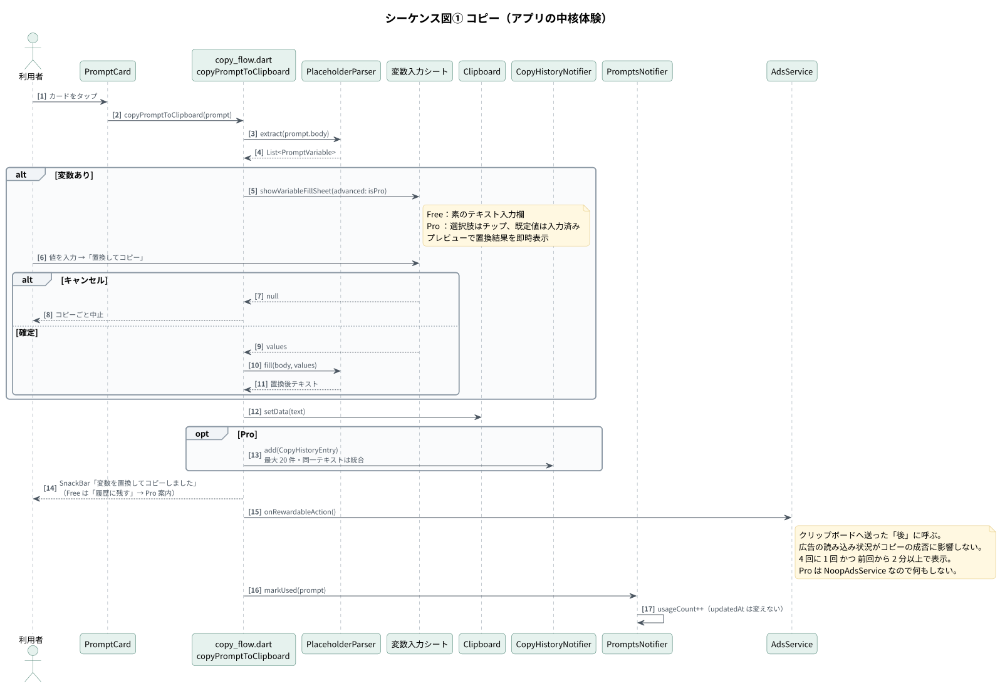
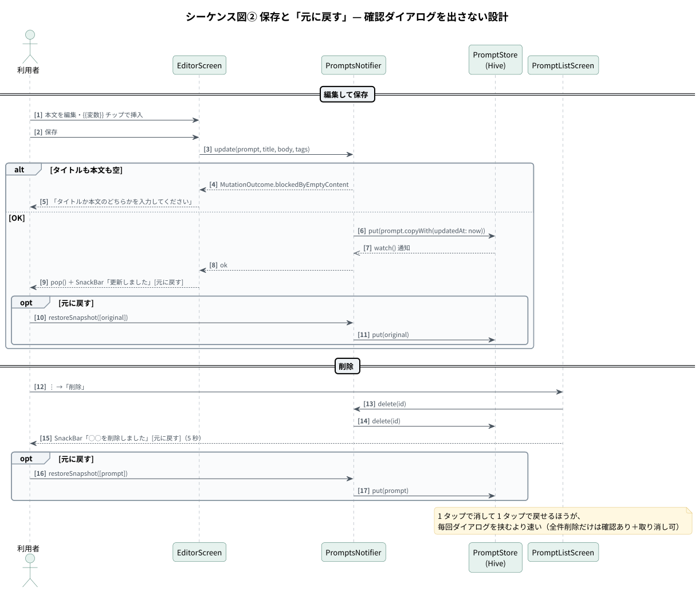
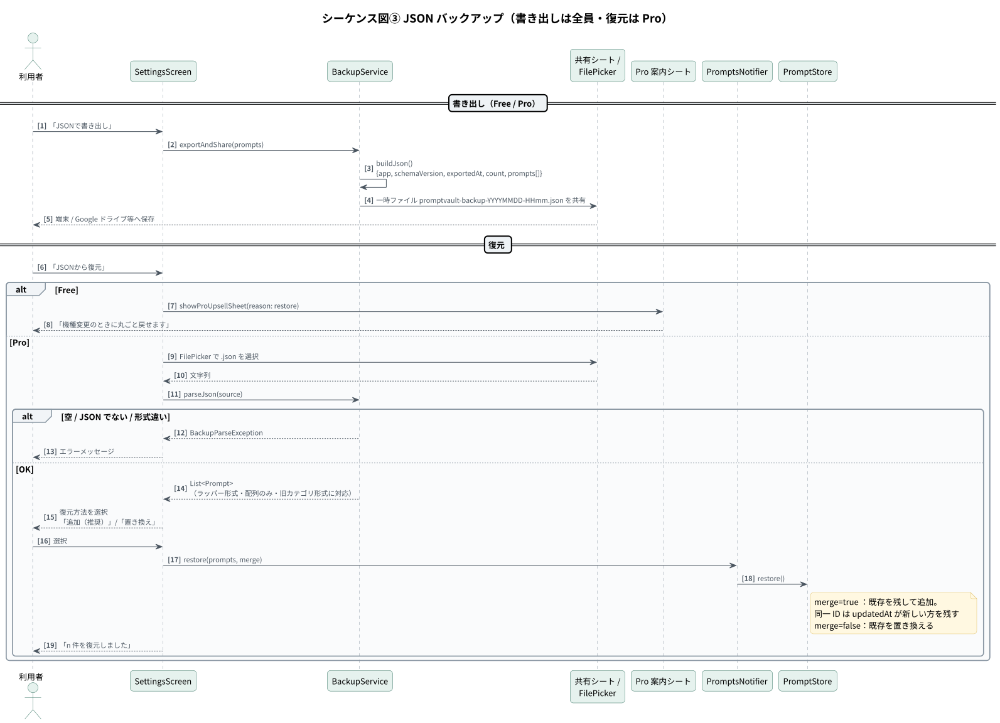
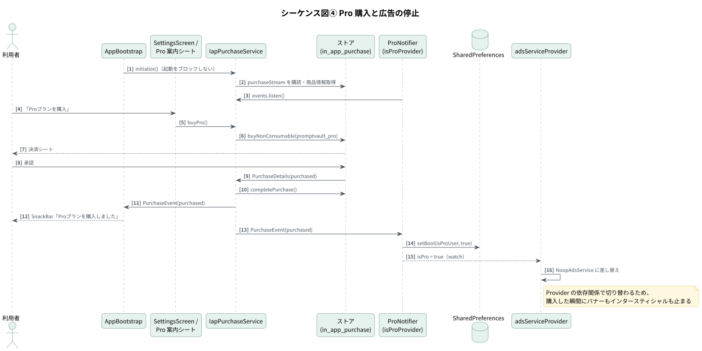

# 設計書 — PromptVault

1. [システム構成](#1-システム構成)
2. [レイヤー構成と責務](#2-レイヤー構成と責務)
3. [クラス図](#3-クラス図)
4. [シーケンス図](#4-シーケンス図)
5. [データ設計](#5-データ設計)
6. [課金と広告の設計](#6-課金と広告の設計)
7. [ディレクトリ構成](#7-ディレクトリ構成)

図の PlantUML ソースは [`diagrams/src/`](diagrams/src/)、SVG は [`diagrams/svg/`](diagrams/svg/) にあります。

---

## 1. システム構成



プロンプトは端末内の Hive にだけ保存し、**プロンプト本文がネットワークに出る経路をアプリ内に持ちません**。外部と通信するのはストア課金（購入・復元時）と、Free ユーザー向けの AdMob 広告だけです。サーバー費は 0 円です。

### ユースケース



---

## 2. レイヤー構成と責務

| レイヤー | 場所 | 責務 |
|---|---|---|
| UI | `lib/ui/` | 画面・ボトムシート。コピーの一連の流れは `copy_flow.dart` に集約 |
| State | `lib/providers/` | Riverpod 3 の Notifier。プロンプト一覧・検索語・選択タグ・並び順・Pro フラグ・コピー履歴 |
| Core | `lib/core/` | **純粋ロジック**。Free / Pro の機能差（`Entitlements`）、検索と並び替え（`PromptQuery`） |
| Services | `lib/services/` | 変数の解析（`PlaceholderParser`）、バックアップ、課金、広告 |
| Data | `lib/data/` | 永続化（`PromptStore` / `CopyHistoryStore`）、初回サンプル |
| Model | `lib/models/` | `Prompt` と手書きの Hive `TypeAdapter` |

### 差し替え可能な設計

| インターフェース | 本番実装 | 差し替え先 | 目的 |
|---|---|---|---|
| `PromptStore` | `PromptRepository`（Hive） | `InMemoryPromptStore` | ウィジェットテストは擬似非同期ゾーンで動き、実ファイル I/O の Future が完了しないため |
| `PurchaseService` | `IapPurchaseService` | `StubPurchaseService` | 非対応プラットフォーム・テスト |
| `AdsService` | `AdMobAdsService` | `NoopAdsService` | **Pro ユーザー**・非対応プラットフォーム・テスト |

`adsServiceProvider` は `isProProvider` を watch しており、Pro に切り替わった瞬間に `NoopAdsService` へ差し替わります。広告を止める処理を個別に書く必要がありません。

### Free / Pro の判定を 1 か所に集約

機能差は `Entitlements`（`lib/core/entitlements.dart`）にだけ書き、UI は `entitlementsProvider` の値を見るだけにしています。

| プロパティ | Free | Pro | 方針 |
|---|---|---|---|
| `variableForm` | ✓ | ✓ | アプリの核心体験。閉じると「ただのメモ帳」に見える |
| `exportBackup` | ✓ | ✓ | データ喪失だけは絶対に起こさせない |
| `showAds` | ✓ | — | Pro の価値その 1：広告が消える |
| `advancedVariables` | — | ✓ | Pro の価値その 2：入力がさらに速くなる |
| `copyHistory` | — | ✓ | 同上 |
| `importBackup` | — | ✓ | 機種変更で「戻したい」と最も強く思う瞬間を課金ポイントにする |

---

## 3. クラス図



---

## 4. シーケンス図

### 4-1. コピー（アプリの中核体験）



### 4-2. 保存と「元に戻す」



### 4-3. JSON バックアップ



### 4-4. Pro 購入と広告の停止



---

## 5. データ設計

### 5-1. Prompt（Hive box `prompts`、typeId = 1）

| フィールド番号 | 名前 | 型 | 説明 |
|---|---|---|---|
| 0 | id | String | 端末内で一意（マイクロ秒 + 16bit カウンタ） |
| 1 | title | String | 空可（一覧では本文 1 行目を見出しにする） |
| 2 | body | String | 本文。`{{変数}}` を含む |
| 3 | （旧 category） | String | **読み込み時のみ**タグへ畳み込む。書き出さない |
| 4 | tags | List&lt;String&gt; | 重複・空白を除去して保持 |
| 5 | isPinned | bool | ピン留め |
| 6 | （旧 sortOrder） | int | 廃止。読み飛ばす |
| 7 | usageCount | int | コピー回数（「よく使う順」） |
| 8 | createdAt | DateTime | |
| 9 | updatedAt | DateTime | 編集時のみ更新（コピー・ピン留めでは変えない） |

`TypeAdapter` は `build_runner` を使わず手書きしています。フィールド番号を据え置くことで、カテゴリ廃止前のデータも**分類情報を失わずに**読み込めます（`Prompt.mergeLegacyCategory`）。

### 5-2. SharedPreferences

| キー | 型 | 内容 |
|---|---|---|
| `isProUser` | bool | Pro 購入済みフラグ |
| `sortMode` | String | `recent` / `usage` |
| `copyHistory` | String（JSON） | コピー履歴（最大 20 件） |
| `adActionCounter` | int | 広告判定用のコピー／保存回数 |
| `lastInterstitialAtMs` | int | 前回インタースティシャルを表示した時刻 |
| `seededStarters` | bool | 初回サンプル投入済み（消したサンプルが再起動で復活しないように） |

### 5-3. バックアップ JSON

```json
{
  "app": "PromptVault",
  "schemaVersion": 1,
  "exportedAt": "2026-07-27T18:30:00.000",
  "count": 5,
  "prompts": [
    { "id": "...", "title": "...", "body": "...", "tags": ["要約"],
      "isPinned": true, "usageCount": 3,
      "createdAt": "...", "updatedAt": "..." }
  ]
}
```

読み込みは**ラッパー形式**・**配列だけの形式**（手書きや他ツールからの移行）・**旧カテゴリ形式**のいずれも受け付け、欠損フィールドは既定値で埋めて例外にしません。

---

## 6. 課金と広告の設計

| 項目 | 設計 |
|---|---|
| 課金形態 | 非消費型（買い切り）`promptvault_pro` |
| Pro 状態の更新 | `ProNotifier` が `PurchaseService.events` を常時購読。決済直後だけでなく、中断した決済が起動時に流れてきた場合も拾う |
| 購入結果の通知 | `AppBootstrap` が同じイベントを購読し、SnackBar を 1 か所から出す（Pro フラグの更新とは責務を分ける） |
| レシート検証 | サーバーを持たない構成のため行わない（ストア SDK の購入状態を信頼） |
| 広告の頻度 | `InterstitialCadence`：**4 回に 1 回** かつ **前回から 2 分以上**。連打で広告が連続しない |
| 広告の呼び出し位置 | クリップボードへ送った**後**。広告の読み込み状況がコピーの成否に影響しない |
| 未読み込み時 | 表示を見送り、先読みだけ行う（コピー体験を止めない） |
| 本番広告 ID | リリースビルドかつ `--dart-define` 指定時のみ使用。既定はテスト ID（開発中に本番広告を叩く事故を防ぐ） |

---

## 7. ディレクトリ構成

```
lib/
├── main.dart                     起動。Hive / SharedPreferences を初期化して DI
├── app.dart                      MaterialApp と起動時の副作用（課金購読・初回投入）
├── core/
│   ├── constants.dart            プロダクト ID・永続化キー・広告の頻度
│   ├── entitlements.dart         Free / Pro の機能差ポリシー
│   ├── prompt_query.dart         絞り込み・並び替え（純粋関数）
│   └── theme.dart
├── models/prompt.dart            ドメインモデル + 手書き Hive アダプタ
├── data/
│   ├── prompt_repository.dart    PromptStore（抽象）と Hive 実装
│   ├── copy_history_store.dart   コピー履歴（Pro）
│   └── starter_prompts.dart      初回投入・サンプル用テンプレート
├── providers/                    Riverpod のプロバイダ定義
├── services/
│   ├── placeholder_parser.dart   {{変数}} の検出・置換・挿入
│   ├── ads_service.dart          AdMob + 表示頻度の制御
│   ├── purchase_service.dart     in_app_purchase ラッパー
│   └── backup_service.dart       JSON の書き出し・読み込み
└── ui/                           画面・ボトムシート・コピーの流れ
test/                             単体・結合・ウィジェットテスト（143 件）＋ スクリーンショット生成
```
