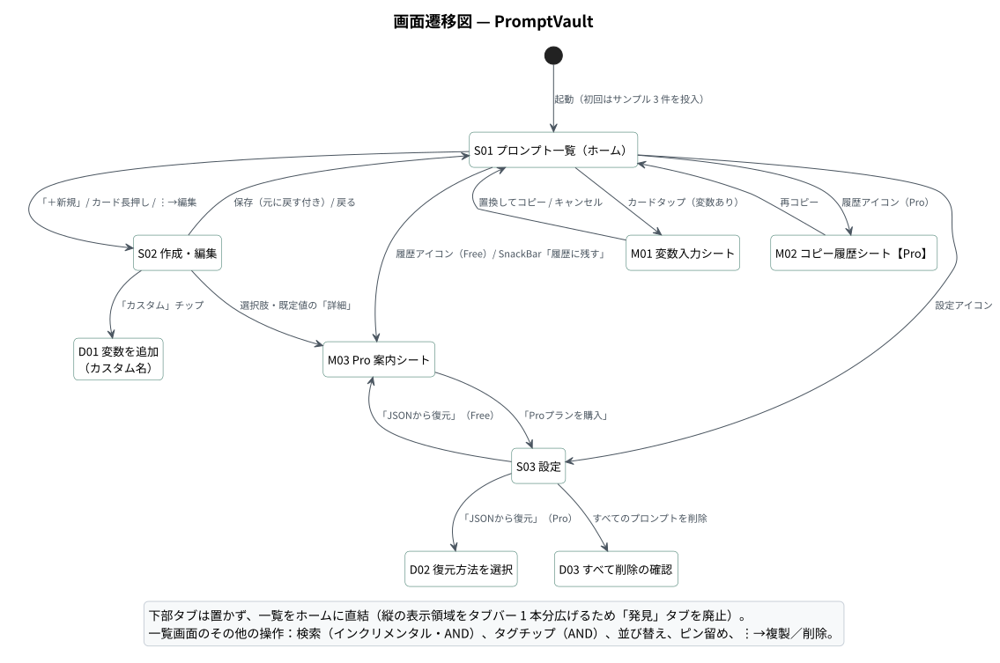
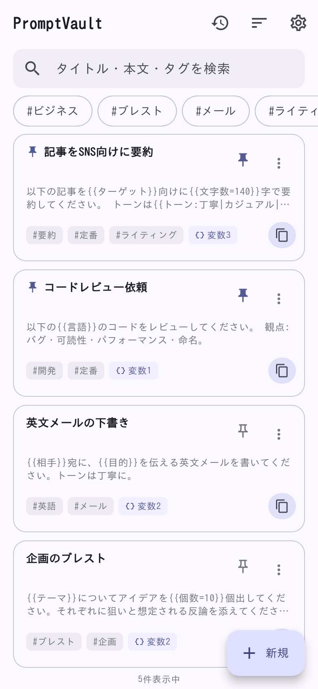
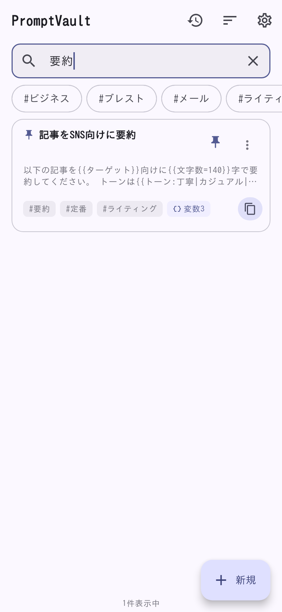
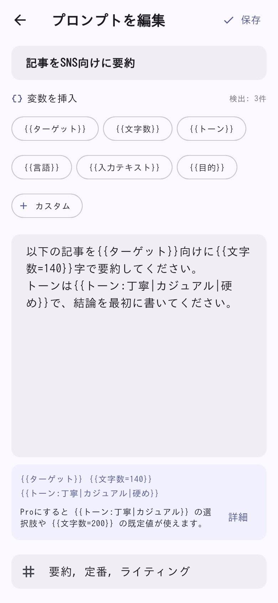
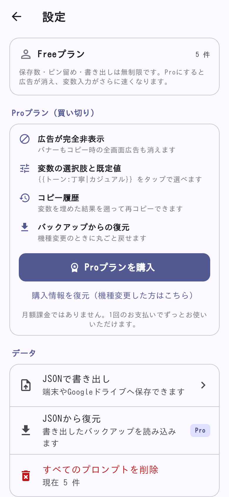
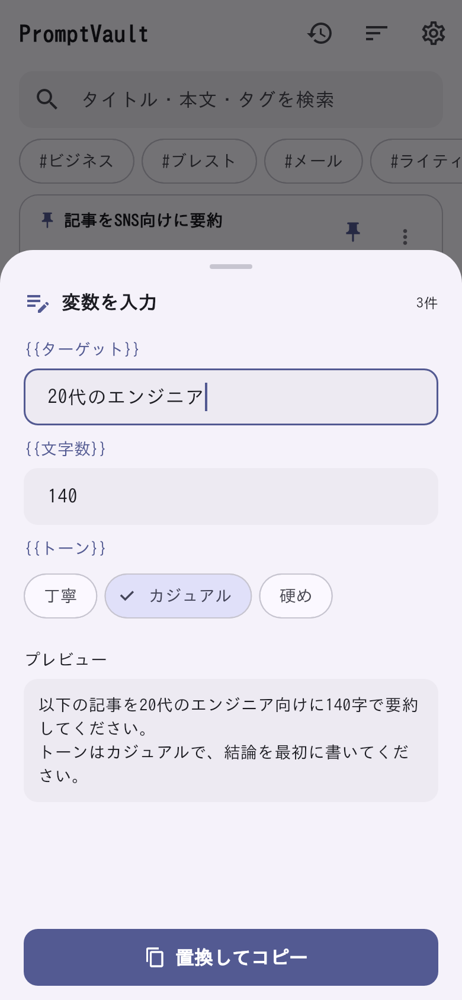
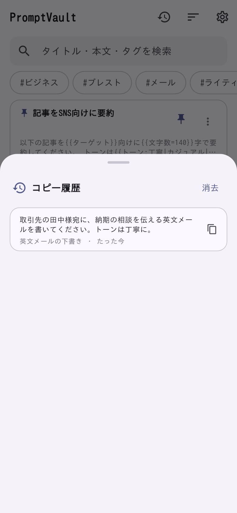
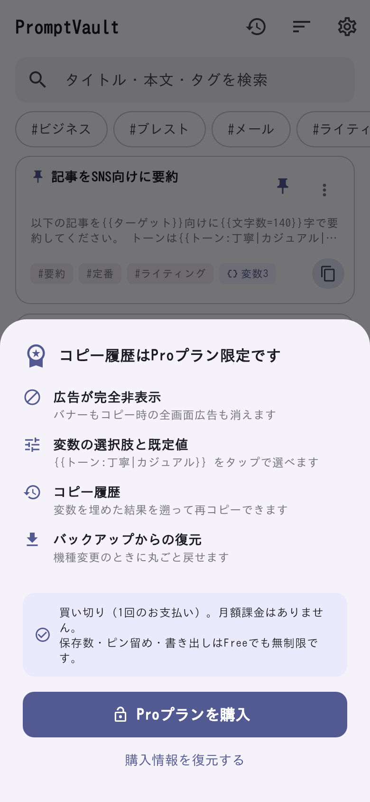

# 画面定義書 — PromptVault

| 項目 | 内容 |
|---|---|
| 対象 | PromptVault v1.0.0（Flutter / iOS・Android） |
| 構成 | 画面 3（一覧・編集・設定）＋ ボトムシート 3 ＋ ダイアログ 3 |
| 画面遷移図 | [diagrams/svg/screen-transition.svg](diagrams/svg/screen-transition.svg) |
| 共通仕様 | ライト／ダーク自動切替。Free は一覧・編集画面の下部にバナー広告。取り消せる操作は確認ダイアログを出さず SnackBar の「元に戻す」で戻す |

---

## 1. 画面一覧

| ID | 名称 | 種別 | 実装（`lib/ui/`） | 概要 |
|---|---|---|---|---|
| S01 | プロンプト一覧 | 画面（ホーム） | `home/prompt_list_screen.dart`, `home/prompt_card.dart` | 検索・タグ絞り込み・並び替え・ピン留め・1 タップコピー |
| S02 | 作成・編集 | 画面 | `editor/editor_screen.dart` | 全画面エディタ、`{{変数}}` 挿入チップ、タグ |
| S03 | 設定 | 画面 | `settings/settings_screen.dart` | プラン、購入／復元、JSON バックアップ、全削除 |
| M01 | 変数入力シート | ボトムシート | `widgets/variable_fill_sheet.dart` | 変数ごとの入力欄とプレビュー、置換してコピー |
| M02 | コピー履歴シート | ボトムシート（Pro） | `widgets/copy_history_sheet.dart` | 過去にコピーしたテキストを再コピー |
| M03 | Pro 案内シート | ボトムシート | `widgets/pro_upsell_sheet.dart` | 文脈に応じた Pro の訴求と購入導線 |
| D01 | 変数を追加 | ダイアログ | `editor/editor_screen.dart` | 任意の変数名を入力して挿入 |
| D02 | 復元方法を選択 | ダイアログ | `settings/settings_screen.dart` | 「追加（推奨）」／「置き換え」 |
| D03 | すべて削除の確認 | ダイアログ | `settings/settings_screen.dart` | 全件削除の確認（削除後も取り消し可） |

---

## 2. 画面詳細

### S01 プロンプト一覧（ホーム）

 

| 項目 | 内容 |
|---|---|
| 遷移元 | 起動直後（初回はサンプル 3 件を自動投入） |
| 遷移先 | S02 / S03 / M01 / M02 / M03 |
| 表示データ | `visiblePromptsProvider` ＝ 全件 → 検索語・選択タグで絞り込み → 並び替え（`PromptQuery.apply`） |

| No | 項目 | 種別 | 内容・表示ルール |
|---|---|---|---|
| 1 | コピー履歴 | アイコン（AppBar） | Pro は M02、Free は M03 |
| 2 | 並び替え | メニュー（AppBar） | 「最近使った順」「よく使う順」。選択は永続化 |
| 3 | 設定 | アイコン（AppBar） | S03 へ |
| 4 | 検索欄 | テキスト入力 | 「タイトル・本文・タグを検索」。入力ごとに即時絞り込み。空白区切りは AND、大文字小文字を区別しない |
| 5 | タグチップ | FilterChip（横スクロール） | 全タグを重複なく表示。複数選択は AND。選択中は「解除」チップを先頭に表示 |
| 6 | プロンプトカード | カード | タイトル（空なら本文 1 行目）、本文プレビュー（120 字）、タグ、変数の数バッジ |
| 7 | ピン留め | アイコンボタン | 件数無制限。ピン留めは並び順に関係なく常に先頭 |
| 8 | ⋮ メニュー | ポップアップ | 編集 ／ 複製（「◯◯ のコピー」）／ 削除 |
| 9 | コピー | アイコンボタン | カードのタップと同じ |
| 10 | 件数 | テキスト | 「n 件表示中」 |
| 11 | 新規 | FAB | S02（新規） |
| 12 | 空状態 | EmptyState | 「最初のプロンプトを作る」「サンプルを追加する」 |
| 13 | バナー広告 | AdMob | Free のみ |

| No | 操作 | 処理 |
|---|---|---|
| 1 | カードをタップ | `copyPromptToClipboard`。変数があれば M01、なければ即コピー（[シーケンス①](diagrams/svg/seq-copy.svg)） |
| 2 | カードを長押し | S02（編集） |
| 3 | 削除 | 確認なしで削除し、5 秒間「元に戻す」を表示 |

| 業務ルール |
|---|
| コピーやピン留めでは `updatedAt` を更新しない（並び順が勝手に変わり、ユーザーが覚えている位置が壊れるのを防ぐ） |
| コピーすると `usageCount` を加算し、「よく使う順」に反映する |

---

### S02 作成・編集

| 項目 | 内容 |
|---|---|
| 遷移元 | S01（新規 FAB／カード長押し／⋮→編集） |
| 遷移先 | 保存・戻るで S01 |

| No | 項目 | 種別 | 内容・表示ルール |
|---|---|---|---|
| 1 | 保存 | テキストボタン（AppBar） | 保存中は無効化 |
| 2 | タイトル | テキスト入力（任意） | ヒント「タイトル（例: ブログ記事の要約）」 |
| 3 | 変数を挿入 | チップ群 | よく使う変数（ターゲット・文字数・トーン・言語・入力テキスト・目的）と「カスタム」。本文のカーソル位置に `{{名前}}` を挿入 |
| 4 | 検出数 | テキスト | 本文から検出した変数の数（「検出: 3件」） |
| 5 | 本文 | 複数行テキスト入力 | 等幅フォント。全画面で編集 |
| 6 | 検出した変数 | 情報カード | 本文に変数があるとき、正規化した記法（`{{文字数=140}}` など）を一覧表示。Pro は記法の説明、Free は「Proにすると選択肢や既定値が使えます」＋「詳細」で M03 |
| 7 | タグ | テキスト入力 | カンマ区切り（`PromptQuery.parseTags` で正規化・重複除去） |
| 8 | バナー広告 | AdMob | Free のみ |

| No | 入力チェック・業務ルール | メッセージ |
|---|---|---|
| 1 | タイトルも本文も空なら保存しない（`MutationOutcome.blockedByEmptyContent`） | 「タイトルか本文のどちらかを入力してください」 |
| 2 | 編集の保存後は直前の内容に戻せる | SnackBar「更新しました」[元に戻す] |

---

### S03 設定

| No | セクション | 項目 | 種別 | 内容・操作 |
|---|---|---|---|---|
| 1 | — | プラン状態 | カード | Free / Pro と保存件数。Free は「保存数・ピン留め・書き出しは無制限」の説明 |
| 2 | Pro プラン | 特典一覧 | リスト | 広告が完全非表示／変数の選択肢と既定値／コピー履歴／バックアップからの復元 |
| 3 | Pro プラン | Proプランを購入 | ボタン | `PurchaseService.buyPro()`（Pro では非表示） |
| 4 | Pro プラン | 購入情報を復元 | リンク | 機種変更・再インストール後に実行 |
| 5 | データ | JSONで書き出し | リスト行 | Free / Pro とも利用可。共有シートで保存先を選ぶ |
| 6 | データ | JSONから復元 | リスト行 | Free は Pro バッジ付きで M03、Pro は D02 |
| 7 | データ | すべてのプロンプトを削除 | 危険操作 | D03 → 削除後も SnackBar で取り消し可（「現在 n 件」） |
| 8 | プライバシー | 説明 | テキスト | 「プロンプトは端末内のみに保存され、外部サーバーへ送信されることはありません」 |
| 9 | アプリについて | バージョン | テキスト | 1.0.0 |
| 10 | デバッグ | Proとして扱う | スイッチ | デバッグビルドでのみ表示 |

---

### M01 変数入力シート

| No | 項目 | 種別 | 内容・表示ルール |
|---|---|---|---|
| 1 | 見出し | テキスト | 「変数を入力」と変数の数 |
| 2 | 変数ごとの入力欄 | テキスト入力 | ラベル `{{名前}}`、ヒント「名前 を入力」 |
| 3 | 選択肢 | ChoiceChip | **Pro のみ**。`{{トーン:丁寧\|カジュアル\|硬め}}` をチップで切り替え |
| 4 | 既定値 | 初期値 | **Pro のみ**。`{{文字数=140}}` の 140 が最初から入る。選択肢は先頭が暗黙の既定値 |
| 5 | プレビュー | テキスト | 置換結果を入力に合わせて即時表示 |
| 6 | 置換してコピー | ボタン | 値の Map を返して閉じる → `PlaceholderParser.fill` → クリップボード |

| 業務ルール |
|---|
| Free でも変数フォーム自体は使える（アプリの核心体験のため）。選択肢・既定値は無視され素の入力欄になる |
| 記法の解析は常に行うため、Free で書いた `{{文字数=200}}` も変数名「文字数」として扱われ、Pro にしても意味が変わらない |
| シートを閉じた（キャンセル）場合はコピーそのものを中止する |

### 変数の記法

| 記法 | 意味 | プラン |
|---|---|---|
| `{{ターゲット}}` | 自由入力 | Free / Pro |
| `{{文字数=200}}` | 既定値つき | Pro（Free は自由入力） |
| `{{トーン:丁寧\|カジュアル}}` | 選択肢（先頭が既定値） | Pro（Free は自由入力） |
| `{{トーン:丁寧\|カジュアル=カジュアル}}` | 選択肢＋既定値を明示 | Pro（Free は自由入力） |

---

### M02 コピー履歴シート（Pro）／ M03 Pro 案内シート

 

| シート | No | 項目 | 種別 | 内容・操作 |
|---|---|---|---|---|
| M02 | 1 | 消去 | テキストボタン | 履歴をすべて消去 |
| M02 | 2 | 履歴 | リスト | 置換後のテキスト・元のプロンプト名・経過時間（「たった今」）。新しい順・最大 20 件・同じテキストは 1 件に統合 |
| M02 | 3 | 再コピー | アイコンボタン | `copyTextToClipboard` で同じ後処理（広告判定含む）を通す |
| M03 | 1 | 見出し | テキスト | 開いた理由（`UpsellReason`）に応じて変わる。例「コピー履歴はProプラン限定です」 |
| M03 | 2 | 特典一覧 | リスト | 広告非表示・選択肢と既定値・コピー履歴・バックアップからの復元 |
| M03 | 3 | 価格の説明 | テキスト | 買い切りで月額課金なし。保存数・ピン留め・書き出しは Free でも無制限 |
| M03 | 4 | Proプランを購入 ／ 購入情報を復元する | ボタン | 購入・復元 |

---

### D01〜D03 ダイアログ

| ID | タイトル | 入力・選択肢 | 結果 |
|---|---|---|---|
| D01 | 変数を追加 | 変数名（例: 業界） | 「挿入」で本文に `{{変数名}}` を挿入 |
| D02 | 復元方法を選択 | 追加（推奨）／置き換え／キャンセル | 追加：同一 ID は `updatedAt` が新しい方を残す。置き換え：既存を全削除して読み込む |
| D03 | すべて削除しますか？ | 削除／キャンセル | 全件削除。SnackBar「n件を削除しました」[元に戻す] |
